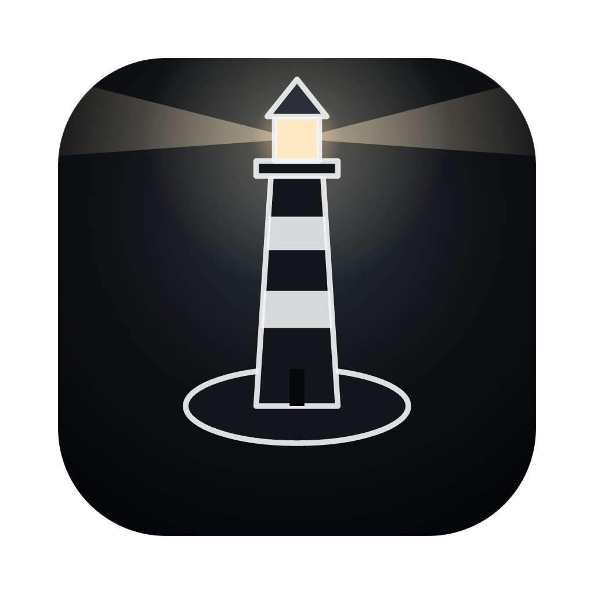

  

<h1 align="center">The Lighthouse</h1>

A survival town-builder about keeping one light burning through the Long Night.

  
  
  

The sun has stopped rising. The last people have gathered around an old lighthouse on a rocky shore, and every night a living Shadow creeps in from the edges of the world. It fills everything the light cannot reach — and it takes anyone left inside.

Build a town in rings around the Lighthouse, put people to work, feed them, and keep the lamp supplied with oil. The nights grow longer every day. Hold out for twenty of them.

- **Light is safety.** Choose how the Lighthouse shines: a steady circle over the town, a long beam reaching far into the dark, or a burst that eats through oil.
- **Every hand counts.** Fishing, oil, wood and iron all need workers, and there are never enough.
- **Fear is the real enemy.** People left in the dark grow afraid; afraid people stop working, and in the end walk into the night.
